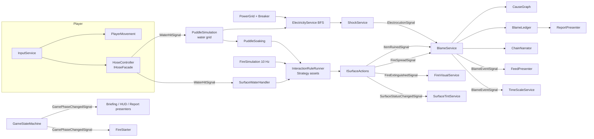
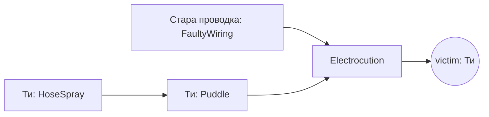

# Flame and Blame — Architecture

A first-person firefighter physics comedy where **every effect remembers who caused it**.
Unity 6 (URP, WebGL), Extenject (DI + SignalBus + MemoryPool), UniTask, new Input System. All visuals are procedural.

## Assemblies

| Assembly | Contents | Depends on |
|---|---|---|
| `FB.Core` | Project-agnostic building blocks: `IPool<T>` / `ComponentPool<T>`, `StateMachine<T>`, `InputService` (actions in code), `CursorService`, low-poly mesh generation, `ProjectInstaller` | Zenject, UniTask, Input System |
| `FB.Game` | Gameplay, blame, UI (by namespace: `Player`, `Hose`, `Surfaces`, `Interactions`, `Fire`, `Puddles`, `Power`, `Blame`, `UI`, `Flow`, `CameraFx`) | `FB.Core` |
| `FB.Editor` | `Tools/Flame&Blame/*`: Build All, Rebuild Level, WebGL/Windows builds, Zenject validation | `FB.Game`, `FB.Core` |

## Composition roots

- **ProjectContext** (`Resources/ProjectContext.prefab`, `ProjectInstaller`) — SignalBus, input, cursor. Survives restarts.
- **SceneContext** (`Game.unity`) — `GameplayInstaller` (all simulation systems) + `UiInstaller` (views + presenters).
  Pressing **R** reloads the scene: the SceneContext is destroyed, every `IDisposable` unsubscribes and cancels its UniTasks.

No singletons, no `Find*`, no static mutable state. Scene objects the code needs (player, hose rig, surfaces, breaker,
UI views) are referenced by installers, and the editor build scripts fill those references.

## Systems and signals

| Signal | Fired by | Consumers |
|---|---|---|
| `GamePhaseChangedSignal` | `GameStateMachine` | `FireStarter`, presenters, `TimeScaleService` |
| `WaterHitSignal` | `WaterJetCollisionHandler` (1 per hit collider per frame) | `SurfaceWaterHandler`, `PuddleSimulation` |
| `FireSpreadSignal` | `SurfaceActions` | `BlameService`, `FireVisualService` |
| `FireExtinguishedSignal` | `SurfaceActions` | `FireVisualService` (steam) |
| `ItemRuinedSignal` | `SurfaceActions` | `BlameService`, `FireVisualService` (sparks) |
| `SurfaceStatusChangedSignal` | `SurfaceActions` | `SurfaceTintService` |
| `ElectrocutionSignal` | `ShockService` | `BlameService` |
| `BlameEventSignal` | `BlameService` | `FeedPresenter`, `TimeScaleService`, debug overlay |

All signals are immutable `readonly struct`s in `Scripts/Game/Signals`.

## The blame model

- `Cause` is an immutable node `{Id, Action, Instigator, Parents}`; only `ICauseFactory` creates them.
- Every effect carries a cause: water per trigger press, `Puddle` (per grid cell) derived from the water that filled it, fire spread with the
  burning source as parent, shocks with **two** parents (puddle + live power source).
- `CauseGraph.CollectRootShares` walks to the roots and splits weight equally between parents at every node:
  the shock above is 50% the player, 50% the old wiring. If the water was made live by a TV the player had
  short-circuited, the power cause itself leads back to the player, so the verdict is 100% "Ти".
- `BlameLedger` adds $ and points per root actor; $ of the player = "firefighter damage", the rest = "fire damage".
- `ChainNarrator` picks Ukrainian lines from `BlameTextConfig` (actor-aware, no repeats in a row).
- The blame core (`CauseGraph`, `BlameLedger`, `ChainNarrator`, `CauseFormatter`) is plain C#.

## Patterns, where to look

| Pattern | Where |
|---|---|
| Dependency Injection | `ProjectInstaller`, `GameplayInstaller`, `UiInstaller` |
| Observer | Zenject SignalBus, all signals above |
| MVP | `*View` (passive MonoBehaviours) + `*Presenter` (plain C#) in `UI/`, `Debugging/` |
| Object Pool | `ComponentPool<T>` over `MonoMemoryPool`: splashes, steam, sparks, fire, arcs, feed lines |
| Factory | `CauseFactory`, editor builders |
| State Machine | `StateMachine<T>` + `BriefingState` / `PlayingState` / `ReportState` |
| Strategy | `IInteractionRule` assets (Extinguish, WaterCooling, WaterDamage x2, NeighborIgnition) |
| Facade | `IHoseFacade`, `ISurfaceActions` (single mutation point for surfaces) |
| Data-driven | ScriptableObject configs for every number, rule, text, color and the level layout |

## Simulation

- Central ticking: `FireSimulation` (fixed 10 Hz), `ElectricityService` (5 Hz), `PuddleSimulation`, `PuddleSoaking`, `ShockService` are
  plain C# `ITickable`s; no gameplay `Update()` on props.
- Fire: heat / ignition / fuel per surface, neighbours cached once with `OverlapBoxNonAlloc`, wet surfaces heat 4x slower.
- Hose: pressure curve, recoil curve against capped player braking (impulses really push), verlet rope with capsule
  segment collisions, leash force past the max length.
- Puddles: the floor is a shallow-water grid (`WaterGrid`, 10 cm cells, 30 Hz). Water lands where the jet hits (or
  drips below), flows to lower neighbours, stops at the film thickness (natural puddle edges), merges, evaporates;
  walls and static furniture are obstacles (found once with `OverlapBox`). Every cell remembers its Cause(Puddle).
  `PuddleSoaking` passes puddle water to objects standing in it through the same interaction rules.
- Electricity: BFS over wet cells from the power strip - only the puddle that touches the strip (and whatever it has
  merged with) is live; a short-circuited appliance replaces the wiring as the blamed power source.
- Water rendering: hand-written URP shaders - `FB/Puddle` (reads the grid texture: calm surface, organic edges,
  meniscus highlight, reflection and glint, ring ripples and foam at impacts, electric veins on live cells) and
  `FB/WaterStream` (aerated fire-hose jet on a LineRenderer traced along the ballistic arc, bubbles, ragged spray
  edges) plus a mist particle cloud around the jet.

## Level and assets

`Tools/Flame&Blame/Build All` generates everything from code and configs, idempotently: palette materials, low-poly
meshes, textures (droplet, flame flipbook, UI sprites), TMP font with Cyrillic (static atlas), prefabs, and
`Game.unity` from `LevelLayoutConfig` (rooms, walls with doorway cut-outs, props with surface data).
Three props (sofa, TV, fridge) use CC0 models from the Kenney Furniture Kit: `ModelPropBuilder` fits them into the
prop box, recolors their materials into the palette and adds a box collider; gameplay data stays identical.

## WebGL

- No threads; UniTask on the PlayerLoop only; every async takes a CancellationToken (unscaled time for UI).
- Gzip + decompression fallback, Minimal stripping, `link.xml` keeps Zenject / UniTask / FB.* / TMP.
- Draw calls: shared GPU-instanced palette materials, static batching, max 4 fire point lights, capped particle counts.
- Hit-stop / slow-mo always restore `Time.timeScale = 1` on report, restart and dispose.
- Shadows are off in the WebGL quality level (`Apply WebGL Settings`): URP 17 on WebGL2 bound a shadow texture to a
  comparison sampler with a mismatching format (`GL_INVALID_OPERATION`) and every Lit draw call was dropped.
  The Windows build keeps shadows.
